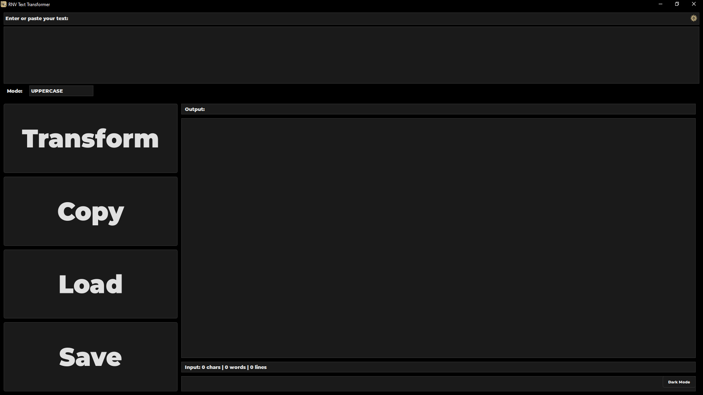
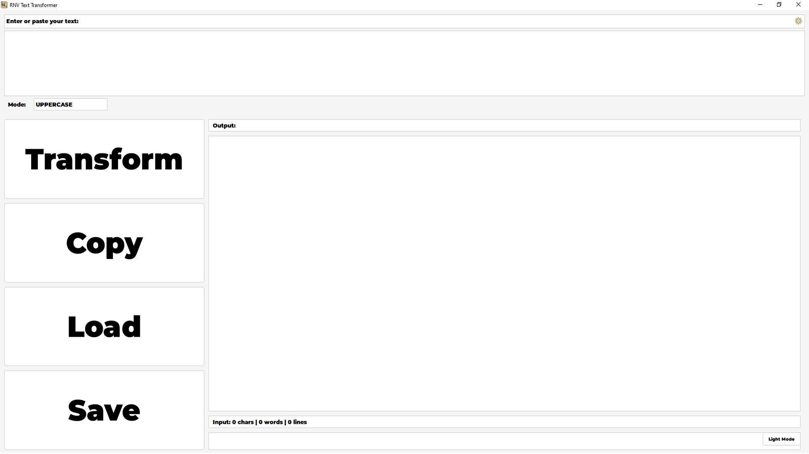
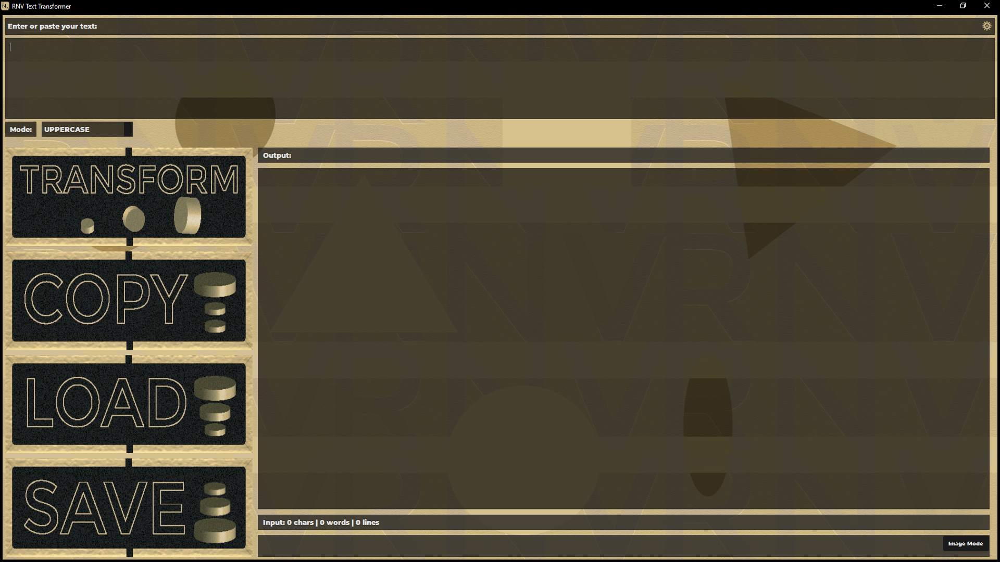
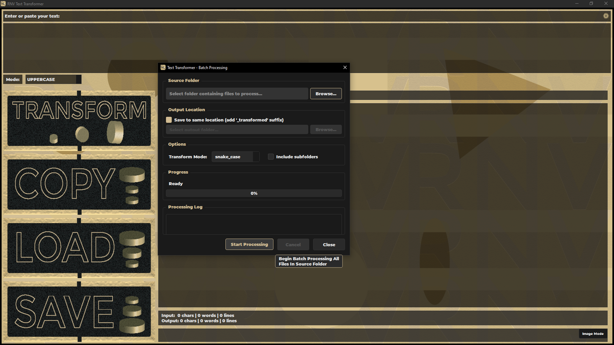
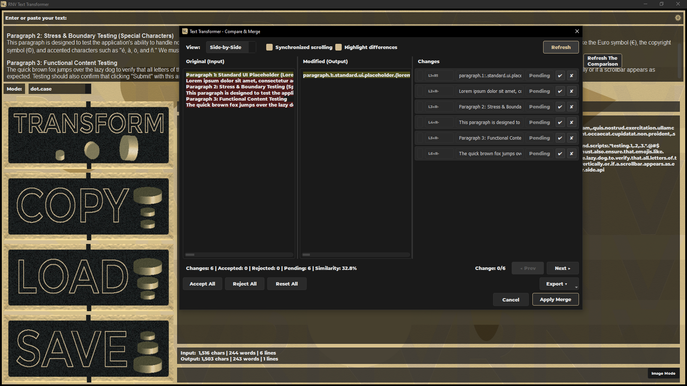
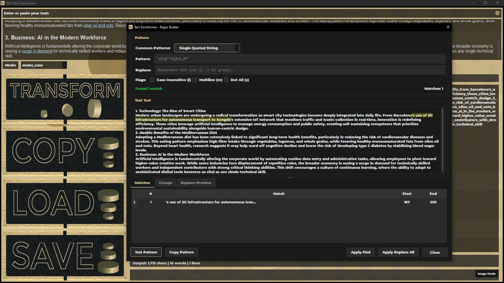

# RNV Text Transformer


[](https://github.com/RNVizion/rnv-text-transformer/actions/workflows/tests.yml)
[](https://github.com/RNVizion/rnv-text-transformer/actions/workflows/tests.yml)

**A professional-grade desktop text transformation suite built with PyQt6.**

RNV Text Transformer is a Windows desktop application for transforming, cleaning, comparing, and batch-processing text across nine file formats. It combines a polished three-theme UI with a command-line interface for scripted transforms and a folder watcher, all backed by a modular, fully type-hinted Python 3.13 codebase.

> Part of the [RNVizion toolkit](https://github.com/RNVizion) — a suite of professional desktop tools for developers and designers.

---

## Table of Contents

- [Highlights](#highlights)
- [Screenshots](#screenshots)
- [Features](#features)
- [Installation](#installation)
- [Usage](#usage)
- [Building a Standalone Executable](#building-a-standalone-executable)
- [Architecture](#architecture)
- [Testing](#testing)
- [Engineering Notes](#engineering-notes)
- [Considered for Later](#considered-for-later)
- [Built With](#built-with)
- [Related Projects](#related-projects)
- [License](#license)
- [Author](#author)

---

## Highlights

- **11 transformation modes** — from the basics (UPPERCASE, Title Case) to developer-focused conversions (camelCase, snake_case, CONSTANT_CASE, kebab-case, dot.case, iNVERTED)
- **9 input formats, 6 export formats** — read `.txt`, `.md`, `.docx`, `.pdf`, `.rtf`, `.py`, `.js`, `.html`, `.log`; export to `.txt`, `.docx`, `.html`, `.pdf`, `.md`, `.rtf`
- **Three theme modes** — dark, light, and a fully custom image mode with gold-accented UI elements
- **CLI** — scriptable, pipe-friendly, with batch and preset support
- **Folder watching** — run transform rules automatically when files land in a directory, while the Watch Folders dialog is open
- **Compare & Merge** — side-by-side or inline diff with synchronized scrolling, and accept or reject each change
- **Regex builder** — test patterns live against sample text: every match highlighted, each match's groups in a table
- **Preset system** — chain transforms, cleanups, replacements, and split/join steps into reusable workflows
- **Modular architecture** — clean separation of `core/`, `ui/`, `utils/`, and `cli/` packages with proper `__init__.py` boundaries
- **Comprehensive test suite** — over 1,000 tests across `unittest`, `pytest`, `hypothesis`, and `syrupy`, running on Linux + Windows CI

---

## Screenshots

| Dark Mode | Light Mode |
|-----------|------------|
|  |  |

| Image Mode | Batch Processing |
|------------|------------------|
|  |  |

| Compare Dialog | Regex Builder |
|----------------|---------------|
|  |  |

---

## Features

### Text Transformation

Eleven transformation modes covering everyday text editing and code-style conversions:

| Category | Modes |
|----------|-------|
| Basic case | UPPERCASE, lowercase, Title Case, Sentence case |
| Developer | camelCase, PascalCase, snake_case, CONSTANT_CASE, kebab-case, dot.case, iNVERTED cASE |

Pick a mode, then **Transform** (`Ctrl+T`). With **Auto-transform** on (Settings), the output follows the input half a second after you stop typing, and changes when you pick another mode. The app remembers the last mode used.

The statistics bar under the output counts characters, words, and lines of the input and the output; Settings moves it above the output or hides it. **Swap** (`Ctrl+Shift+S`) moves the output into the input for a chained transform, and **Clear** (`Ctrl+Shift+X`) empties both panes.

### File I/O

Every file loads on a background thread, so the UI never freezes:

- **Text / code:** `.txt`, `.md`, `.py`, `.js`, `.html`, `.log`
- **Documents:** `.docx`, `.pdf`, `.rtf`
- **Export targets:** `.txt`, `.docx`, `.html`, `.pdf`, `.md`, `.rtf`

Load a file with **Load** (`Ctrl+O`), from the recent files menu (`Ctrl+Shift+O`), or by dropping it on the input pane; a loaded file is transformed at once. Files over 50 MB are refused. **Save** (`Ctrl+S`) writes the output as plain text; **Export** (`Ctrl+E`) writes the other formats.

Right-click the input pane for Cut, Copy, Paste, Select All, Clear, and Load File; right-click the output pane for Copy, Copy All, Select All, and Save As. **Copy** (`Ctrl+Shift+C`) puts the whole output on the clipboard.

### Advanced Tools

- **Find & Replace** (`Ctrl+F`, `Ctrl+H`) — Case sensitive, Whole word, and Regular expression options, and a choice to search the input or the output. Every match is highlighted in the pane searched; Find Next steps through them, and Replace and Replace All edit that pane. A replacement in the output joins its undo history.
- **Regex Builder** (`Ctrl+R`) — a library of common patterns, the flags Case Insensitive, Multiline and Dot All, and test text in which every match is highlighted as you type. Its tabs list the matches (click one to select it), each match's groups, and a preview of the replacement. **Apply Find** opens Find with the pattern; **Apply Replace All** rewrites the input.
- **Text cleanup** (Settings > Adjustments) — trim whitespace, remove extra spaces, extra or all blank lines, and leading or trailing spaces; fix line endings to LF or CRLF; remove duplicate lines; sort lines A-Z or Z-A; strip HTML tags; remove non-printable characters; normalize Unicode. Each applies to the input.
- **Split / Join** (Settings > Adjustments) — split the input into lines at each comma, semicolon, tab, or space, or join its lines with one of them.
- **Compare & Merge** (`Ctrl+D`) — the input against the output, side by side or inline (unified), with synchronized scrolling and highlighted differences. Accept or reject each change, or all of them, then **Apply Merge** writes the result to the output. **Export** saves a unified diff (`.diff`), an HTML report, side-by-side text, or text with conflict markers.
- **Encoding converter** (`Ctrl+Shift+E`) — detect the input's encoding (the confidence is shown as a percentage and as high, medium, or low), convert it to another, choose how characters that can't be converted are handled, and optionally repair mojibake (text decoded with the wrong encoding). Preview the conversion, then apply it to the input.
- **Undo/redo history** for the output (`Ctrl+Z`, `Ctrl+Y`), up to ten states
- **Recent files** with persistent history: the `Ctrl+Shift+O` menu and Settings > History, holding as many files as *Maximum recent files* in Settings allows (10 unless changed)
- **Export** (`Ctrl+E`) — format, title, line numbers, metadata, font and size, an HTML dark theme and inline CSS, PDF page numbers, and a preview of the first lines. Under the format, the dialog says whether the library it needs is installed; Export is off when it is not.

### Keyboard Shortcuts

| Shortcut | Action |
|----------|--------|
| `Ctrl+T` | Transform |
| `Ctrl+Shift+C` | Copy the output to the clipboard |
| `Ctrl+O` | Load a file |
| `Ctrl+Shift+O` | Recent files menu |
| `Ctrl+S` | Save the output |
| `Ctrl+E` | Export |
| `Ctrl+Shift+X` | Clear both panes |
| `Ctrl+Shift+S` | Swap input and output |
| `Ctrl+Z` | Undo the output |
| `Ctrl+Y` | Redo the output |
| `Ctrl+F` | Find |
| `Ctrl+H` | Find & Replace |
| `Ctrl+R` | Regex Builder |
| `Ctrl+B` | Batch processing |
| `Ctrl+D` | Compare & Merge |
| `Ctrl+Shift+E` | Encoding converter |
| `Ctrl+P` | Preset manager |
| `Ctrl+W` | Watch folders |
| `Ctrl+Shift+T` | Cycle the theme |
| `Ctrl+,` | Settings |
| `Ctrl+/` | About |
| `F11` | Tooltips on or off |
| `Ctrl+Q` | Quit |

The About dialog and Settings > Quick Actions list the same shortcuts.

### Automation

- **Batch processing** (`Ctrl+B`) — apply a transform mode to every supported file in a folder, and in its subfolders if you choose. Results go to an output folder, or beside each source with a `_transformed` suffix; a `.docx`, `.pdf`, or `.rtf` source is written as `.txt`.
- **Folder watching** (`Ctrl+W`) — each rule names an input folder, an output folder, file patterns (such as `*.txt, *.md`), a preset, and a transform mode (a rule with both runs the preset first), and can process the files already there when watching starts and delete each source after processing. Rules are saved with the settings. Watching runs while the Watch Folders dialog is open and stops when it closes; the dialog's log shows each file processed.
- **Preset system** (`Ctrl+P`) — chain steps into reusable named workflows. A step is one of ten actions: Transform, Cleanup, Replace, Regex Replace, Prefix, Suffix, Wrap Text, Split, Join, or Trim Lines; each can be switched off or moved. Presets can be duplicated, imported, and exported as JSON. Six built-in presets are read-only; duplicate one to change it. The CLI and watch-folder rules use the same presets.

### Themes

- **Dark mode** with the brand gold accent
- **Light mode** with a deeper gold accent, for contrast on light surfaces
- **Image mode** with fully custom background imagery and transparent UI overlays

The theme button in the bottom-right corner (`Ctrl+Shift+T`) cycles the modes, and the app remembers the last one. Values for both golds and every other color are in [`COLORS.md`](COLORS.md); [`docs/RNV_Brand_Color_System.md`](docs/RNV_Brand_Color_System.md) says which part of the app takes which.

A custom themed-tooltip system bypasses native Qt tooltip rendering to deliver consistent cross-platform styling ([`docs/RNV_Custom_Tooltip_System.md`](docs/RNV_Custom_Tooltip_System.md)). `F11`, or *Show button tooltips* in Settings, turns the main window's button tooltips on or off, and the app starts the same way next time.

### Settings

The gear in the top-right corner (`Ctrl+,`) opens Settings, in five tabs:

- **Settings** — default theme, Auto-transform, button tooltips, *Maximum recent files* (0 to 20; *Disabled* keeps none, and lowering it drops the oldest files from the list at once), Clear Recent Files, and where the statistics bar sits.
- **Adjustments** — the cleanup and split/join operations above, Clear All, Swap, Undo, and Redo.
- **Export** — the export formats, and a button that opens the Export dialog.
- **History** — recent files; double-click one to open it.
- **Quick Actions** — the keyboard shortcuts.

### CLI

The command-line interface covers the transform modes, the presets, the cleanup operations, and batch runs over files or folders. Find & Replace, Compare, the Regex Builder, the encoding converter, and export are in the GUI only.

`rnv-transform` is installed by `pip install -e .`; without it, run `python -m cli.rnv_transform` from the repository root, with the same arguments.

```bash
# Transform a file
rnv-transform input.txt --mode snake_case --output result.txt

# Batch-process a folder
rnv-transform ./docs/ --mode "Title Case" --output-dir ./converted/ --recursive

# Apply a preset
rnv-transform input.txt --preset "Code Variable Cleanup" --output clean.txt

# Apply cleanup operations, in order
rnv-transform input.txt --cleanup trim_whitespace,remove_blank_lines --output clean.txt

# Pipe from stdin to stdout
cat input.txt | rnv-transform --mode lowercase > output.txt

# Discovery
rnv-transform --list-modes
rnv-transform --list-presets
rnv-transform --list-cleanup
```

| Option | Meaning |
|--------|---------|
| `input ...` | Files, folders (with `-r`), glob patterns, or `-` for stdin. With no input and piped stdin, stdin is read. |
| `-m`, `--mode MODE` | Transformation mode, as `--list-modes` names it (for example `UPPERCASE`, `snake_case`) |
| `-p`, `--preset NAME` | Apply a preset by name, as `--list-presets` names it |
| `-c`, `--cleanup OPS` | Cleanup operations, comma-separated, by the names `--list-cleanup` prints (for example `trim_whitespace`) or as the GUI names them (`"Trim Whitespace"`) |
| `-o`, `--output FILE` | Output file, for one input. Without `-o` or `-d`, each file is **rewritten in place**; stdin goes to stdout. |
| `-d`, `--output-dir DIR` | Output folder for batch runs (made if missing); files keep their names |
| `-r`, `--recursive` | Take every file under a folder, and let `**` in a glob match subfolders |
| `-f`, `--force` | Overwrite an existing output file |
| `-e`, `--encoding ENCODING` | Encoding of the files written (default `utf-8`) |
| `-v`, `--verbose` | Report each file and step on stderr |
| `-q`, `--quiet` | Print errors only |
| `--version` | Print the app's name and version |

The cleanup operations run first, then the preset, then the mode. `rnv-transform --help` prints the full list. The exit code is 0 when every file was written, and 1 when a file was not or an argument was wrong.

---

## Installation

### Prerequisites

- Python 3.13
- Windows 10/11 (primary target; Linux works too — CI runs against both)

### Setup

```bash
# Clone the repository
git clone https://github.com/RNVizion/rnv-text-transformer.git
cd rnv-text-transformer
```

To run the app only, install `requirements.txt` into a Python 3.13 environment:

```bash
pip install -r requirements.txt    # the app's own packages
pip install -e .                   # also installs the rnv-transform command
```

To develop or run the tests, use the setup scripts below.

### Setting up for development

Two scripts at the repository root set up a checkout. Both install the same two files:
`requirements.txt`, which is what the app needs to run, and `tests/requirements-dev.txt`,
which adds the test tools and rnv-brand at the commit this repository pins.

```powershell
# Windows (PowerShell 7)
.\in.ps1                      # makes .venv with Python 3.13 if there is none, then installs
.\.venv\Scripts\Activate.ps1
```

```bash
# Linux or Codespaces
./in.sh                       # also installs the Qt system libraries with apt-get
```

rnv-brand is installed from GitHub at a pinned commit, so the second file needs `git` and
network access. Run the script again after any change that moves the pin; the
register-pin test fails while the installed brand is not the pinned one.

---

## Usage

### Launch the GUI

```bash
python RNV_Text_Transformer.py
```

### Run the CLI

```bash
python -m cli.rnv_transform --help
```

### Clean build artifacts

```bat
clean_python_cache.bat      # Windows
./clean_python_cache.sh     # macOS / Linux
```

### Changing a color

The app's colors live in `utils/colors.py`, but their values are not edited there.
`brand_map.json`, at the repository root, says where each one comes from: a name in
rnv-brand (such as `APP.accent`) or a value this app owns, with the reason.
`tools/sync_colors.py` writes the value on each of those lines, and writes `COLORS.md`, the
chart of this app's colors.

- **A color this app owns:** change its value in `brand_map.json`, then run
  `python tools/sync_colors.py`.
- **A brand color:** it changes in rnv-brand first. Move the pin in
  `tests/requirements-dev.txt`, reinstall (above), then run `python tools/sync_colors.py`.
  The diff of `utils/colors.py` shows exactly what moved. The `brand-sync` workflow does
  this every day and opens a pull request only when a color this app uses has moved.
- `python tools/sync_colors.py --check` writes nothing and exits 1 if the color file or
  `COLORS.md` is out of date. `tests/test_colors_in_sync.py` runs it on every test run, so
  a value edited by hand in `utils/colors.py` fails the suite until the map says the same.

A derived color, such as a lightened or translucent step of the gold, stays code in
`utils/colors.py` and follows its base.

**The images do not follow.** Button art, backgrounds and icons have the gold drawn into
their pixels. `ACCENT_IMAGES.md` lists every image that carries it; `tools/accent_images.py`
writes that list (`--check` writes nothing) and never changes an image.
`tests/test_accent_images.py` keeps the list current.

### Files the app keeps

Presets are written atomically through `utils/atomic_write.py`: the new content goes to a
temporary file beside the real one, is flushed to disk, and replaces the original in one step.
A crash or a full disk during a save leaves the old file or the new one, never half of each.
Settings, recent files and watch-folder rules are kept by Qt's `QSettings`. Exports you ask
for, such as a document or a diff report, are not state and keep their own writers.
`tests/test_atomic_state_writes.py` lists every writer and fails if one writes in place.

---

## Building a Standalone Executable

The project ships with [PyInstaller](https://pyinstaller.org/) build scripts for both platforms. Each script auto-activates `.venv` if present, verifies PyInstaller is installed, cleans previous build artifacts, runs the build against `RNV_Text_Transformer.spec`, and reports the output location.

```bash
# Windows
build_windows.bat

# Linux / macOS
chmod +x build_linux.sh    # first time only
./build_linux.sh
```

Output lands at `dist/RNV Text Transformer/`. The spec file bundles the full `resources/` folder, resolves lazy-imported dependencies (`docx`, `pypdf`, `reportlab`, `watchdog`), excludes unused heavy libraries, and suppresses the console window on Windows.

To produce a single-file distribution instead of a folder, see the commented alternative block at the bottom of `RNV_Text_Transformer.spec`.

If you'd rather invoke PyInstaller manually:

```bash
pip install pyinstaller
pyinstaller --noconfirm RNV_Text_Transformer.spec
```

---

## Architecture

The project follows a clear four-package layout that separates concerns:

```
rnv-text-transformer/
├── RNV_Text_Transformer.py       # GUI entry point
├── requirements.txt
├── pyproject.toml
├── brand_map.json                 # Where each color comes from: rnv-brand or the app
├── COLORS.md                      # This app's color chart, written by the sync
├── ACCENT_IMAGES.md               # The images that carry the gold, written by tools/accent_images.py
├── LICENSE
├── README.md
├── ARCHITECTURE.md
├── CHANGELOG.md
├── py.typed
├── RNV_Text_Transformer.spec      # PyInstaller build spec
├── RNV_Text_Transformer.pyproj    # Visual Studio project file
│
├── in.sh                          # Development setup for Linux/Codespaces
├── in.ps1                         # Development setup for Windows
├── build_windows.bat              # One-click build for Windows
├── build_linux.sh                 # One-click build for Linux/macOS
├── clean_python_cache.bat         # Cache cleanup for Windows
├── clean_python_cache.sh          # Cache cleanup for Linux/macOS
├── run_tests.py                   # Both suites under coverage, one report
├── pytest.ini
├── .coveragerc
│
├── core/                          # Business logic
│   ├── text_transformer.py        # 11 transformation modes
│   ├── text_cleaner.py            # Cleanup and split/join operations
│   ├── text_statistics.py         # Word/line/character analysis
│   ├── diff_engine.py             # Text comparison
│   ├── export_manager.py          # Multi-format export
│   ├── preset_manager.py          # Preset storage and execution
│   ├── regex_patterns.py          # Pattern library
│   ├── resource_loader.py         # Image and resource caching
│   ├── theme_manager.py           # Dark/Light/Image theme state
│   ├── batch_processor.py         # Folder batch processing
│   └── folder_watcher.py          # Folder monitoring and watch rules
│
├── ui/                            # PyQt6 widgets and dialogs
│   ├── main_window.py             # Primary application window
│   ├── base_dialog.py             # Common dialog base class
│   ├── image_button.py            # Image-mode-aware button
│   ├── drag_drop_text_edit.py     # Drop-target text widget
│   └── *_dialog.py                # 10 specialized dialogs
│
├── utils/                         # Cross-cutting utilities
│   ├── colors.py                  # The app's colors and the two palettes, their values written by the sync
│   ├── config.py                  # Single source of truth for version, paths, constants
│   ├── dialog_styles.py           # The dialog stylesheets, drawn from those palettes
│   ├── file_handler.py            # Multi-format file I/O
│   ├── settings_manager.py        # QSettings-backed persistence
│   ├── atomic_write.py            # Atomic writes for the files the app keeps
│   ├── clipboard_utils.py         # Clipboard operations
│   ├── async_workers.py           # Background QThread workers
│   ├── error_handler.py           # Centralized error routing
│   ├── dialog_helper.py           # Common dialog helpers
│   └── logger.py                  # Color-coded structured logging
│
├── cli/                           # Command-line interface
│   └── rnv_transform.py
│
├── docs/
│   ├── RNV_Brand_Color_System.md  # Which palette key each part takes
│   └── RNV_Custom_Tooltip_System.md
│
├── tests/                         # Pytest suite
│   ├── requirements-dev.txt       # Test dependencies
│   ├── conftest.py                # Shared fixtures
│   ├── color_values.py            # Color values the tests need that are not the app's
│   ├── __snapshots__/             # Syrupy snapshots
│   ├── test_*.py                  # The tests, each file opening with what it holds
│   └── README.md                  # Test suite documentation
│
├── resources/                     # Static assets
│   ├── button_images/
│   ├── background_images/
│   ├── fonts/
│   ├── icons/
│   └── screenshots/               # README screenshots
│
├── tools/
│   ├── sync_colors.py             # Writes the colors in utils/colors.py, and COLORS.md
│   └── accent_images.py           # Writes ACCENT_IMAGES.md
│
├── .github/workflows/             # CI workflows
│   ├── tests.yml                  # Linux + Windows test matrix
│   └── brand-sync.yml             # Daily: colors from rnv-brand; a pull request only if one moved
│
└── test_rnv_text_transformer.py   # unittest regression suite
```

### Design Principles

- **Single source of truth.** All colors live in `utils/colors.py`, the `DARK` and `LIGHT` palettes among them, with their values written from `brand_map.json` (see *Changing a color*). The version string lives only in `utils/config.py`, as `APP_VERSION`; this README does not repeat it.
- **Centralized styling.** Every dialog but About inherits from `BaseDialog`, which delegates appearance to `DialogStyleManager` — a single stylesheet generator with LRU caching for performance.
- **Pre-warmed caches.** At startup, the app pre-warms the stylesheet cache and pre-loads button images so the first dialog opens instantly.
- **Threaded file I/O.** Every file loads on `FileLoaderThread`; transforms of large text run on `TextTransformThread`. The UI never blocks.
- **Type hints everywhere.** All modules use modern Python type syntax (`str | None`, `list[str]`, `ClassVar`, `__slots__` for memory efficiency).
- **Lazy imports.** Heavy libraries (`docx`, `pypdf`, `striprtf`, `reportlab`) are imported only when needed, keeping cold-start fast.

For full architectural detail — dependency rules, startup sequence, threading model, signal flow, caching strategy, extension points, and known constraints — see [ARCHITECTURE.md](ARCHITECTURE.md).

---

## Testing

The project ships with **over 1,000 tests across two complementary suites**, run on both Linux and Windows. CI runs the full suite on every push and pull request.

### Quick start

```bash
# Run everything (both suites + combined coverage report)
python run_tests.py

# Run only the pytest suite (benchmarks are timed too unless --benchmark-disable is passed)
python -m pytest tests/ --benchmark-disable

# Run only the unittest suite
python -m unittest test_rnv_text_transformer
```

Run them with the venv's Python, as `python -m`; `run_tests.py` runs `coverage` through the
same interpreter.

### Suite composition

| Suite | Tests | Purpose |
|-------|------:|---------|
| `test_rnv_text_transformer.py` (unittest) | over 300 | Regression suite — core logic, file I/O, transformations, exports, error handling. |
| `tests/` (pytest) | over 600 | UI interactions, property-based tests (`hypothesis`), snapshot tests (`syrupy`), benchmarks, CLI tests, coverage gap-fill, and guard tests |

### Coverage

Coverage is measured on every full run. `python run_tests.py --report` prints the current
figure for every module; it differs a little between Windows and Linux. CI prints the report
at the end of each job.

### Methodology

The test plan uses multiple complementary techniques:

- **`unittest`** for the core regression suite
- **`pytest` + `pytest-qt`** for headless UI interaction tests (qtbot, signal verification, modal dialog mocking)
- **`hypothesis`** for property-based testing of idempotent transformations
- **`syrupy`** for snapshot testing of generated stylesheets, color dictionaries, export output formats, and diff renderings
- **`pytest-benchmark`** for performance regression tracking
- **`coverage.py`** with branch coverage enabled

The full suite is documented in [`tests/README.md`](tests/README.md), including the guard tests, conventions for fixtures, modal dialog mocking, and the QThread testing pattern that sidesteps `coverage.py`'s limitation on `QThread.run()` instrumentation.

---

## Engineering Notes

The test suite caught **four production bugs** during development, each with a dedicated regression-guard test:

| # | Bug | Found by | Severity |
|---|-----|----------|----------|
| 1 | `remove_duplicate_lines` was non-idempotent for non-LF separators | Hypothesis property test | Logic |
| 2 | Four sibling cleanup functions shared the same idempotency bug | Hypothesis property test | Logic |
| 3 | `preset_dialog._setup_ui` called a method name that didn't exist on `TextCleaner`, crashing the CLEANUP step UI | qtbot interaction test | Crash |
| 4 | `watch_folder_dialog._load_rule` silently overwrote `rule.file_patterns` to `["*.txt"]` on every dialog open, causing silent data loss of user-saved patterns | qtbot interaction test | **Data loss** |

Bug #4 is the most consequential — the dialog would quietly destroy multi-pattern rules (e.g. `["*.py", "*.md"]`) every time a user opened it and made any change. No crash, no error message, no warning. It went undetected through normal manual testing because the corruption was only visible by inspecting the saved settings file. The regression guard test now exercises the multi-pattern load path explicitly.

The methodology that found these bugs — property-based testing for pure logic, interaction testing with qtbot for UI flows — is documented further in `tests/README.md`.

---

## Considered for Later

### Line numbers in the text panes

**What it would be.** A gutter down the left edge of the input and output panes that numbers their lines, marks the line the caret is on, and can be hidden. It serves text where a line's number is how a place in it is named: code, logs, and the formats among those the app reads (`.py`, `.js`, `.html`, `.log`) where a reader is told "see line 120".

**What there was.** A widget for it, `ui/line_number_text_edit.py`: `LineNumberTextEdit`, and a rich-text variant, with a gutter, the caret's line marked, a switch to hide the numbers, and a method to go to a line. Nothing in the app created it: both panes are another class, and no menu, setting or shortcut reached it. It knew dark and light but not image mode; in dark its text area stayed white, so the caret's marked line could not be read; and it lacked what the panes have, from a dropped file to the right-click menu and the app's styling. It was removed on 11 October 2026, with the four colors it read in each palette (`line_number_bg`, `line_number_fg`, `line_number_current_bg`, `line_number_current_fg`) and the tests that built it.

**What would need to be decided before it is built again.**

- **Which panes.** The input, the output, or both; and whether the output's numbers follow the input's lines, which a transform keeps and a cleanup that removes lines does not.
- **On or off, and where the switch lives.** A setting with a default, a menu entry, a shortcut, or all three; and whether the choice is remembered between runs.
- **How it looks in each mode.** Dark, light and image, from palette entries named for the gutter's ground, its numbers and the caret's line. In image mode the gutter sits over the background image, as the panes do. Each color shown drawn, read back from the pixels, and the numbers held to 4.5:1 on their ground.
- **Wrapped lines.** Whether a line the pane wraps is numbered once, as a line of the file, or on each row it fills.
- **The caret's line.** Marked in the gutter only, or across the pane as well, and how that sits with Find's highlights, which are drawn over the text.
- **Going to a line.** Whether it is offered, and from where: a menu, a shortcut, or Find.
- **Large files.** The gutter repaints as the view scrolls; how large a file it must stay smooth on.
- **Where it is built.** Into the panes' own class, not beside it: dropping a file, the right-click menu, the output's undo history, Find's highlights and the theme switch all live there.

---

## Built With

- **[Python 3.13](https://www.python.org/)** — language
- **[PyQt6](https://pypi.org/project/PyQt6/)** — GUI framework
- **[Pillow](https://pypi.org/project/Pillow/)** — image processing for theme backgrounds
- **[python-docx](https://pypi.org/project/python-docx/)** — Word document I/O
- **[pypdf](https://pypi.org/project/pypdf/)** — PDF reading
- **[reportlab](https://pypi.org/project/reportlab/)** — PDF export
- **[striprtf](https://pypi.org/project/striprtf/)** — RTF parsing
- **[chardet](https://pypi.org/project/chardet/)** — encoding detection
- **[watchdog](https://pypi.org/project/watchdog/)** — folder monitoring

### Test stack

- **[pytest](https://docs.pytest.org/)** + **[pytest-qt](https://pytest-qt.readthedocs.io/)** — UI test runner with Qt event-loop integration
- **[hypothesis](https://hypothesis.readthedocs.io/)** — property-based testing
- **[syrupy](https://github.com/syrupy-project/syrupy)** — snapshot testing
- **[pytest-benchmark](https://pytest-benchmark.readthedocs.io/)** — performance benchmarking
- **[coverage.py](https://coverage.readthedocs.io/)** — coverage tracking with branch coverage
- **[rnv-brand](https://github.com/RNVizion/rnv-brand)** — the brand register, at the commit `tests/requirements-dev.txt` pins, which the color tests compare against

---

## Related Projects

Part of the RNVizion suite of professional desktop tools:

- **[RNV Icon Builder](https://github.com/RNVizion/rnv-icon-builder)** — Create multi-resolution ICO files from PNG, ICO, and SVG sources with platform-specific exports (Android, iOS, favicon).
- **[RNV Color Picker](https://github.com/RNVizion/rnv-color-picker)** — Extract, organize, and export colors from images or the screen with 15+ palette formats.
- **[RNV Color Mixer](https://github.com/RNVizion/rnv-color-mixer)** — Bringing real-world paint mixing to the digital palette.

---

## License

[MIT](LICENSE) — free to use, modify, and distribute.

---

## Author

Built by [RNVizion](https://github.com/RNVizion)

---

<p align="center">
  Built with PyQt6 · over 1,000 tests
</p>
